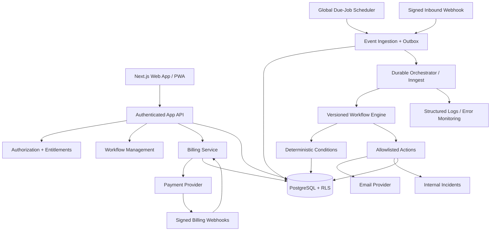
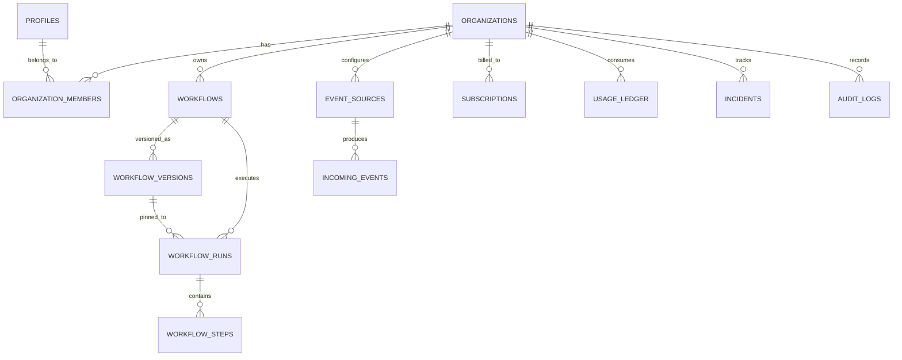

# FUTUREFLOW — FINAL UNIFIED MASTER PLAN & ASTRA EXECUTION PROMPT

**Version:** 2.0 — Consolidated single-file handoff  
**Prepared:** 17 October 2026  
**Document name:** `FUTUREFLOW_FINAL_MASTER.md`  
**Status:** Product and engineering proposal. No implementation or production safety has been certified.  
**Audience:** Product owner, GitHub-aware coding agents, ChatGPT Astra, engineering team  
**Target:** India-first multi-tenant automation SaaS; global-ready architecture

> **Single-source-of-truth rule:** This file supersedes `FUTUREFLOW_MASTER_PLAN.md` and `FUTUREFLOW_OPEN_SOURCE_REFERENCE_PACK.md`. No second input document is needed. Read all sections before acting. The authoritative, copy-ready agent prompt is at the **end (Section 17)**. The initial execution scope is **Phase 0 audit followed by Phase 1 foundation only**. No production deployment, protected-branch push, irreversible changes or live payments without explicit authorization.

## Contents

1. Executive summary and positioning
2. Product requirements and MVP acceptance criteria
3. Technology stack and architecture decisions
4. System design and reliable event pipelines
5. Versioned workflow definitions
6. Multi-tenant relational database and RLS
7. Security and abuse prevention
8. Pricing, subscriptions, usage and unit economics
9. API contracts and integration boundaries
10. Project folder structure
11. Phase 0–6 implementation roadmap and gates
12. Testing, observability and definition of done
13. Risks and open decisions
14. Open-source repository references and reverse-engineering audit
15. Agent artifacts and licensing rules
16. Official repository/documentation URLs
17. **FINAL MASTER PROMPT for Astra**

---

## 1. Executive summary

**FutureFlow** is a multi-tenant, event-driven automation SaaS that helps individuals and small teams turn important events into reliable actions:

**Detect → Evaluate → Decide → Execute → Verify**

Users define workflows such as:

- **Website monitor:** When `https://example.com/health` fails twice consecutively, open an incident and send an email. On recovery, resolve the incident.
- **Inbound webhook:** When an authenticated JSON webhook has `priority = "critical"`, notify the operations team.
- **Deadline:** When a tracked renewal date is within seven days, email an assigned teammate.

**Positioning:** Not “another general-purpose Zapier clone.” The wedge is **reliable, evidence-rich, condition-based automation for technical and operational teams**, with clear explanations, constrained integrations, secure team workspaces, and predictable billing.

### 1.1 Goals

1. A new user can create and test a useful automation in under five minutes.
2. Every workflow execution is traceable: trigger, evaluated conditions, executed actions, outcomes, retries, and costs/usage.
3. Strong tenant isolation and least-privilege access are built in from the first migration.
4. Automations execute durably with idempotent handling of retries, webhooks, and side effects.
5. Organizations can subscribe, manage teams, view usage, and understand quota enforcement.
6. Architecture stays simple enough for a solo developer but can evolve into a real commercial SaaS.

### 1.2 Non-goals for V1

- Hundreds of third-party integrations or an open connector marketplace.
- Arbitrary user-supplied JavaScript or code execution.
- Autonomous AI performing irreversible actions without approval.
- General enterprise compliance certification, guaranteed SLAs, or regional data residency claims.
- Native mobile apps or browser extensions.
- Fully fledged visual programming with loops, arbitrary joins, or unbounded recursion.
- Custom customer-hosted workflow workers or microservice orchestration.

### 1.3 Customer segments

| Segment | Job to be done | Initial appeal |
|---|---|---|
| Solo developer | Know when my site or API breaks, and see why | Website/endpoint monitoring with incident history |
| Small SaaS team | Turn system events into accountable responses | Webhooks, team notifications, auditable runs |
| Agency / managed service provider | Monitor separate clients without mixed data | Organizations, members, quotas, per-client workflows |
| SMB operations team | Avoid missing deadlines and important events | Deadline and conditional reminder workflows |

The initial niche should be **developers, web agencies, and small SaaS teams**. Expand toward generic business automation only after learning from real customers.

---

## 2. PRD: product requirements

### 2.1 Core product model

- **User:** Authenticated human identity.
- **Organization / workspace:** Billing, ownership, security, and quota boundary. Users may belong to multiple organizations.
- **Membership:** A user's role in one organization.
- **Workflow:** User-facing automation with draft and published versions.
- **Workflow version:** Immutable, validated definition snapshot used for each run.
- **Trigger:** Scheduled health probe, signed webhook, or deadline.
- **Event:** An immutable, normalized occurrence originating from a source.
- **Condition:** Deterministic evaluation of typed event data and, where allowed, maintained state.
- **Action:** Allowlisted operation, such as send email or create/update an incident.
- **Run:** One accepted workflow execution bound to a specific version and event.
- **Step:** An individually observable node execution with output, status, and attempt history.
- **Incident:** A durable record opened and resolved by monitoring workflows.
- **Entitlement:** Effective limits and features for an organization based on billing state.
- **Usage unit:** Customer-visible billable metric distinct from provider infrastructure usage.

### 2.2 Feature prioritization

#### P0 — Launch-critical (must work end to end)

- Email/password or supported OAuth authentication, logout, reset, verified email where needed.
- Create/switch organizations; owner/admin/editor/viewer authorization.
- Secure member invitations with expiration and single-use tokens.
- Create draft workflows; validate/publish; pause/resume; version history.
- Three trigger types: scheduled HTTP health check; authenticated inbound webhook; scheduled deadline.
- Typed conditions (comparison, AND/OR, consecutive failures, date operators).
- Three primary actions: email notification; internal incident create/update; audit/event record.
- Durable run execution, bounded retries, deduplication, idempotency, cancellation where safe.
- Run list with drill-down to trigger, node statuses, errors, retries, and timestamps.
- Subscription plan definitions, workspace billing, quotas, subscription-state reconciliation, payment webhook processing.
- Rate limiting, tenant isolation, secret protection, actionable error handling, logging and tests.
- Responsive dashboard, guided onboarding, plan/usage visibility, and accessible UI.

#### P1 — After the working vertical slice

- React Flow visual editor with read-only execution overlay and test/simulation mode.
- Workflow templates and version comparison/rollback.
- Approval gates for sensitive future connectors.
- Team notifications and richer incident lifecycle (acknowledge, assign, close, recovery).
- Advanced condition builder, schedule timezone support, execution filters and exports.
- More administrative tooling: member management, billing history, structured usage reports.

#### P2 — Intelligence and advanced operations

- Natural-language **draft** generation for supported workflows only.
- AI explanation of failed runs and proposed fixes with source evidence.
- Recommendations based on historical anomalies, with explicit opt-in.
- Advanced alert suppression, deduplication, incident escalation, and connector health.

#### P3 — Platform and enterprise expansion

- Connector SDK and developer docs, third-party integrations and templates marketplace.
- SSO/SAML, advanced audit export, granular permissions, agency/white-label capabilities.
- Multi-region strategy where economically and contractually justified.
- Separate enterprise billing and contractual service terms.

### 2.3 MVP workflows and acceptance criteria

**Scenario A — Website incident**

1. Organization creates a monitor for a public, permitted HTTP(S) endpoint.
2. System validates address, plan minimum interval, timeout, rate limit, and safe destination.
3. Scheduler probes at configured cadence within documented scheduling tolerances.
4. Two consecutive qualifying failures create **one open incident** and trigger **one email notification** for that transition, not repeated emails every failing probe.
5. Successful probes reset the failure counter; after configured recovery threshold, resolve the incident and optionally email recovery.
6. Run history shows probe evidence (response/error category, timing, timestamp, redacted URL if necessary) and state transitions.

**Scenario B — Webhook event**

1. User creates a signed webhook event source and receives a unique endpoint and a secret shown once.
2. A valid request passes body-size limit, signature, replay-window, and deduplication checks.
3. Matching typed conditions produce one accepted workflow run.
4. Duplicate deliveries with the same approved event key never create duplicate billable runs or duplicate effects.
5. Invalid requests fail with safe error responses and security telemetry, without leaking secrets.

**Scenario C — Upcoming deadline**

1. User stores date, timezone, lead time, recipient, and notification template.
2. A scheduled check identifies the event at the appropriate point.
3. The system sends a single reminder per configured occurrence, even if the scheduler retries.
4. User can edit/deactivate future occurrences; previous runs retain their published version references.

### 2.4 UX / information architecture

**Public:** Home, Features, Use Cases, Pricing, Documentation, Security, Contact, Sign-in/Sign-up.  
**Private workspace:** Overview, Workflows, Workflow editor, Runs, Incidents, Sources/Connections, Usage, Billing, Members, Workspace settings, User profile.  
**Admin operations (internal):** Event intake, failed jobs, provider status, webhook reconciliation, high-risk abuse review, service metrics (restricted access).

The interface should be professional, responsive, accessible (keyboard navigation, meaningful labels, contrast, reduced motion), fast, and clear about actual vs simulated events.

**Onboarding happy path:** sign up → create organization → choose “Website down alert” template → add endpoint and recipient → validate → test safely → activate → review first run.

---

## 3. Technology stack and design decisions

| Layer | Recommendation | Rationale / caveat |
|---|---|---|
| Web | Next.js App Router + React + TypeScript | One deployable web app and typed server APIs |
| Styles / components | Tailwind CSS + shadcn/ui | Accessible and adaptable design system |
| Visual editor | React Flow (`@xyflow/react`) | Graph editor; introduce after engine is correct |
| Validation | Zod | Typed runtime validation for API and workflow JSON |
| DB + auth | Supabase PostgreSQL + Supabase Auth | Relational source of truth, RLS, managed authentication |
| Query / migrations | Drizzle ORM + SQL migrations | Typed access; raw reviewed SQL for RLS/policies |
| Background orchestration | Inngest | Durable execution, events, retries, concurrency controls |
| Scheduled dispatch | One global due-job dispatcher, then durable jobs | Avoid assuming per-tenant dynamic cron is available without constraints |
| Email | Resend or equivalent | Transactional alerts; provider abstraction |
| AI | Server-side AI adapter / OpenAI API | Optional P2 feature; usage is separately metered |
| India billing | Razorpay Subscriptions (subject to verification) | Hosted checkout/recurring billing; provider adapter |
| Deploy | Vercel for Next.js | Simple initial deployment |
| Logs / errors | Structured logs + Sentry | Safe observability and trace IDs |
| Tests | Vitest, Playwright, DB integration tests | Security + execution + payments |
| Monorepo / CI | pnpm, Turborepo, GitHub Actions | Dependency boundaries and automated gates |

**Foundation candidate:** Choose **one** between Makerkit Lite (featureful Next.js/Supabase/Turborepo foundation) and the smaller official Supabase Next.js template, after Phase 0 audit. Treat `nextjs/saas-starter` as an architecture/UI reference unless independent compatibility review supports adoption. Do not transplant Stripe/custom-auth implementation into the intended Supabase Auth + Razorpay design.

**Versions:** Pin current, stable, mutually compatible versions when initializing the repository. Verify official provider documentation and terms at implementation time. **No external vendor free-tier, price, performance or country availability statement in this plan is guaranteed current.**

### 3.1 Architecture principles

1. **Modular monolith first:** clear domain package boundaries, not independent microservices.
2. **Database as source of truth:** all critical events, workflow versions, run status, entitlements, and usage are persisted transactionally.
3. **Durable execution:** orchestrator is a transport/executor, not the sole source of business records.
4. **Organization-scoped access everywhere:** security through server authorization plus PostgreSQL RLS where applicable.
5. **Validated, allowlisted workflow operations:** no arbitrary scripts.
6. **Version everything consequential:** schemas, published workflows, pricing/entitlement snapshots, migrations.
7. **At-least-once processing, idempotent effects:** do not advertise universal exactly-once execution.
8. **Human review for sensitive actions:** especially payment, deletion, or third-party account changes.
9. **Cost-aware from day one:** billable workflow runs, probes, AI usage and platform executions are distinct meters.
10. **Provider portability:** billing, email, AI, and orchestrator behind stable interfaces.

---

## 4. System architecture



### 4.1 Dynamic scheduling: feasible implementation

Dynamic customer schedules are not the same as a handful of static application cron expressions. Implement:

1. Persist monitor/deadline schedules in Postgres with `next_run_at`, cadence, timezone where relevant, and version.
2. Invoke a **single global dispatcher** approximately every minute (or a coarser interval until 1-minute service is enabled).
3. In a DB transaction, claim due schedules using `FOR UPDATE SKIP LOCKED` and a bounded batch; update lease/`next_run_at` safely.
4. Write the intended event to a transactional outbox within the same transaction.
5. An outbox relay publishes jobs to Inngest, retries failed publishing, and marks dispatch status.
6. Durable worker revalidates tenant entitlement and published workflow snapshot before action execution.
7. Throttle by organization/endpoint and prevent overlapping probes to the same target; treat delayed dispatch separately from downtime.

**Do not** generate an unlimited number of dynamic per-user cron registrations. Use bounded batches, queue backpressure, and a plan-aware dispatcher.

### 4.2 Incoming webhook pipeline

Receive raw bytes → validate body size/content type → identify source by unguessable identifier → verify HMAC signature over canonical raw request plus timestamp → reject expired/replayed signatures → validate JSON schema → deduplicate event → transactionally persist event/outbox → acknowledge safely → asynchronously execute.

Do not accept `organization_id` supplied by the sender as authoritative. The event source itself maps to the owning organization. Store signing secrets encrypted or hashed where suitable and implement rotation.

### 4.3 Run and action pipeline

1. Consume normalized event or due schedule with durable delivery.
2. Resolve organization and active published workflow version.
3. Check access and entitlement; skip safely if paused, expired, or over quota.
4. Persist a unique `workflow_run` with a stable `execution_key` and reserve quota atomically.
5. Evaluate the typed graph with deterministic conditions and bounded computation.
6. Execute allowlisted actions; persist step state before/after external effects.
7. Use an action idempotency key such as `(run_id, node_id, logical_action_key)`.
8. On retriable error, apply bounded exponential backoff and jitter; on ambiguous non-idempotent external outcomes, reconcile before reattempting.
9. Finalize run, produce audit trail, settle usage reservation, and update metrics.

### 4.4 Action guarantees

- **Internal DB effects:** unique constraints + DB transactions make effective deduplication possible.
- **Email:** provider idempotency if supported, plus local delivery records; otherwise deduplicate as much as possible and handle uncertain sends carefully.
- **Third-party side effects:** only promise idempotence when the provider supports unique request keys, reliable status lookup, or an equivalent contract.
- **Retries:** retryable/timeouts/permanent failures must be classified explicitly.
- **Outages:** after temporary worker/provider outages, replay persisted undelivered outbox items and stuck runs under safe policies.

### 4.5 State transitions

Workflow: `draft → active ↔ paused → archived`. Publishing creates immutable versions.  
Run: `queued → running → succeeded | failed | skipped | canceled | requires_review`.  
Step: `pending → running → succeeded | failed | skipped | waiting_approval | requires_review`.  
Incident: `open → acknowledged → resolved` (with dedup key to prevent multiple concurrent open incidents for one condition).

Terminal transitions must be guarded against race conditions; state must never regress because an old worker finishes late.

---

## 5. Workflow definition contract

Use an immutable published **versioned JSON DAG** that only references registered trigger/condition/action operations.

```json
{
  "schemaVersion": 1,
  "name": "Website Incident Monitor",
  "trigger": {
    "type": "http.health_check",
    "config": {
      "url": "https://example.com/health",
      "intervalMinutes": 5,
      "timeoutSeconds": 10
    }
  },
  "nodes": [
    {
      "id": "failure_gate",
      "type": "condition",
      "config": { "operator": "consecutive_failures_gte", "value": 2 }
    },
    {
      "id": "open_incident",
      "type": "action",
      "config": { "provider": "internal", "operation": "create_incident" }
    },
    {
      "id": "send_email",
      "type": "action",
      "config": {
        "provider": "email",
        "operation": "send_notification",
        "template": "website_down"
      }
    }
  ],
  "edges": [
    { "from": "failure_gate", "to": "open_incident", "when": "true" },
    { "from": "open_incident", "to": "send_email", "when": "success" }
  ]
}
```

**Publication checks:**

- Validate complete JSON with strict Zod schemas and a supported `schemaVersion`.
- Reject cycles, unreachable nodes, unknown types, unknown operators, missing required connections, excessive graph complexity and invalid targets.
- Verify current organization plan/quotas, connection permissions and actor role.
- Persist immutable version and atomically update active pointer; do not mutate definitions used by in-flight runs.
- Differentiate event schema from workflow definition schema.
- Never expose arbitrary expressions, unrestricted regex, user code execution, SQL, shell commands or unrestricted outbound requests in V1.

**Condition semantics:** Typed AND/OR, equality, greater/less-than, null checks, date comparisons, consecutive-failure state. Specify stable null handling, timezone behavior and rounding; use bounded recursion/depth.

---

## 6. Data model and database

### 6.1 Tenancy strategy

Use **one shared PostgreSQL database, shared schema, organization-based tenant ownership**. An organization is the billing and security boundary. Tenant-owned tables carry `organization_id` even if indirectly derivable, allowing explicit authorization and composite constraints.

### 6.2 Logical relationships



### 6.3 Tables (proposed)

**Identity and organizations**

| Table | Primary fields and rules |
|---|---|
| `profiles` | `user_id` (Auth FK/PK), `display_name`, `avatar_url`, timestamps |
| `organizations` | `id`, `name`, globally unique `slug`, `owner_id`, lifecycle status, timestamps |
| `organization_members` | `(organization_id,user_id)` unique, `role`, `status`, `joined_at` |
| `organization_invites` | `id`, `organization_id`, invitee email, role, `token_hash`, `expires_at`, `accepted_at`, created_by |
| `organization_settings` | organization_id, default timezone, notification preferences, retention policy |

**Workflows and events**

| Table | Primary fields and rules |
|---|---|
| `workflows` | `id`, `organization_id`, `name`, `status`, `active_version_id`, created_by, timestamps |
| `workflow_versions` | `id`, `organization_id`, `workflow_id`, monotonic `version`, `schema_version`, `definition_json`, `created_by`, `published_at`; immutable |
| `event_sources` | `id`, `organization_id`, `type`, non-secret config, `secret_ref`, `status` |
| `incoming_events` | `id`, `organization_id`, `source_id`, `event_key`, safe/redacted `payload_json`, `received_at` |
| `schedules` | `id`, `organization_id`, `workflow_id`, version_id, `next_run_at`, `interval_seconds`, `timezone`, lease, enabled |
| `outbox_events` | `id`, `organization_id`, event_type, aggregate_id, payload_ref, dispatch status, attempts, next attempt |
| `monitor_states` | organization_id, workflow_id, target fingerprint, consecutive_failures, consecutive_successes, last status, updated_at |

**Execution and incidents**

| Table | Primary fields and rules |
|---|---|
| `workflow_runs` | `id`, `organization_id`, `workflow_id`, `version_id`, `incoming_event_id`, `execution_key`, status, timestamps, error_class |
| `workflow_steps` | `id`, `organization_id`, `run_id`, `node_id`, status, attempts, safe input/output refs, timestamps |
| `action_deliveries` | `id`, organization_id, `run_id`, `node_id`, `idempotency_key`, provider, external_id, delivery status |
| `incidents` | `id`, organization_id, workflow_id, dedup key, status, open/resolve timestamps, assigned_to |
| `notification_deliveries` | `id`, organization_id, run_id, channel, recipient ref, external message id, status |
| `approvals` | `id`, organization_id, run_id, action id, requested_by, decided_by, expiry, decision (P1) |

**Billing / usage / credentials / observability**

| Table | Primary fields and rules |
|---|---|
| `plans` | plan code/version, price, currency, billing interval, feature config, published status |
| `subscriptions` | `id`, organization_id, provider, provider subscription id, status, period start/end, cancel flags |
| `billing_events` | provider, `provider_event_id` unique, verified payload reference, received/processed timestamps, status |
| `entitlements` | organization_id, metric, effective limit, feature code, period, origin/subscription version |
| `usage_reservations` | id, organization_id, metric, billing period, run/event id, amount, state, expiration |
| `usage_ledger` | id, organization_id, metric, quantity, reason, run/event id, idempotency key, period start, created_at; immutable |
| `connections` | id, organization_id, provider, encrypted secret reference, status, last tested_at |
| `audit_logs` | id, organization_id, actor id/type, action, resource reference, safe details, created_at |

**Indexes and constraints:**

```sql
-- Representative constraints. Adapt to the actual migration/schema.
CREATE UNIQUE INDEX organizations_slug_ux
  ON organizations(slug);
CREATE UNIQUE INDEX incoming_events_dedupe_ux
  ON incoming_events(organization_id, source_id, event_key);
CREATE UNIQUE INDEX workflow_runs_dedupe_ux
  ON workflow_runs(organization_id, execution_key);
CREATE UNIQUE INDEX billing_events_dedupe_ux
  ON billing_events(provider, provider_event_id);
CREATE UNIQUE INDEX action_deliveries_dedupe_ux
  ON action_deliveries(organization_id, idempotency_key);
CREATE UNIQUE INDEX workflow_versions_ux
  ON workflow_versions(organization_id, workflow_id, version);
CREATE INDEX workflow_runs_org_recent_idx
  ON workflow_runs(organization_id, started_at DESC);
CREATE INDEX schedules_due_idx
  ON schedules(next_run_at) WHERE enabled = true;
CREATE INDEX outbox_pending_idx
  ON outbox_events(next_attempt_at) WHERE status = 'pending';
```

Use compound foreign keys, such as `(organization_id, workflow_id)` pointing to a tenant-scoped unique key, so a row from one tenant cannot reference another tenant's workflow even via mistakes in privileged background code. Define suitable foreign key indexes and cascade/restrict semantics; do not indiscriminately cascade audit/billing history.

### 6.4 RLS and authorization

- Enable and test RLS on **every tenant-owned table exposed to client-facing queries**.
- Prefer application server access for sensitive write paths (billing, publishing, credentials, usage), with explicit organization membership authorization.
- Build reusable, carefully tested SQL membership helpers or equivalent policies.
- Restrict role changes, organization ownership transfer, billing management, and secrets to elevated roles.
- A service-role DB connection bypassing RLS **must** explicitly authorize tenant scope in every job; never treat service role as automatically safe.
- Test authenticated User A/Org A versus User B/Org B, users with both memberships, suspended members, revoked invites, and member role changes.
- Use audit logs for sensitive organizational changes.

---

## 7. Security, privacy and abuse prevention

### 7.1 Threat model highlights

1. Cross-tenant data leakage via missing filters, joins, background workers or storage access.
2. SSRF through HTTP monitor URLs, redirects, IPv6, DNS rebinding, alternative IP encodings and metadata addresses.
3. Webhook forgery/replay and unbounded payload ingestion.
4. Duplicate or runaway automations causing excessive emails, costs or third-party actions.
5. Billing webhook forgery and inaccurate entitlements.
6. Credential leakage in logs, prompts, database JSON, client bundles and support exports.
7. Malicious or compromised organization users modifying workflows they cannot own.
8. PII in notifications, third-party integrations and AI model inputs.

### 7.2 Required controls

- Strict tenant-scoped authorizations, RLS and composite FK integrity.
- Secure signed webhooks with timestamped HMAC and a deduplication/replay window.
- Webhook payload cap, schema validation, ingress rate limits and signed secret rotation.
- For HTTP checks: HTTP(S) only; DNS resolution checked against public IP ranges before every connection; reject private, link-local, multicast, loopback, metadata and disallowed IPs (v4/v6); enforce redirects policy and revalidate each hop; bound connect/read timeouts and response byte sizes; no user-configurable privileged request headers in V1; enforce per-domain and per-org probe limits.
- Prefer an HTTP probing service/worker with restrictive egress controls; never rely on regex URL validation alone.
- Encryption at rest for connector secrets, application-level authenticated encryption for tokens, and key storage outside the database.
- CSP and secure session/cookie settings, CSRF defenses where needed, safe redirect handling, and rate limits.
- Explicit email recipient validation, suppression/unsubscribe policy for non-essential messaging, notification caps, and abuse reporting.
- Data minimization, documented retention/deletion, customer exports, backup encryption and restore tests.
- Separate development/staging/production environments and credentials.
- AI prompts exclude raw secrets and unneeded personal/customer data.
- Legal review for Privacy Policy, Terms, taxes/invoices, consent, data processing and applicable India privacy requirements before commercial launch.

---

## 8. Billing, subscriptions, and monetization

### 8.1 Business model

**Freemium + subscriptions + enforceable usage quotas.** Each organization has one active commercial plan; members inherit organization entitlements.

**Important:** Prices below are a *hypothesis* for market testing, **not verified customer willingness-to-pay or guaranteed profit**. Taxes, provider fees, discounts, operating costs and region restrictions require validation.

### 8.2 Suggested initial price matrix (INR, per workspace, pre-tax)

| Feature | Free | Starter | Pro | Business |
|---|---:|---:|---:|---:|
| Monthly price | ₹0 | ₹499 | ₹1,499 | ₹4,999 |
| Active workflows | 3 | 20 | 100 | 500 |
| Workflow runs/month | 300 | 5,000 | 25,000 | 100,000 |
| HTTP health probes/month **across all monitors** | 3,000 | 10,000 | 150,000 | 1,000,000 |
| Members | 1 | 2 | 5 | 20 |
| Fastest health check | 15 min | 5 min | 1 min | 1 min |
| Execution history retention | 3 days | 30 days | 90 days | 180 days |
| Core webhook and deadline triggers | Yes | Yes | Yes | Yes |
| Dedicated support / SLA | No | No | No | Negotiate separately |

**Quota example:** A continuously monitored site checked every 15 minutes consumes about 2,880 checks per 30-day month; at 5 minutes about 8,640, and at 1 minute about 43,200. These counts are **per monitor**, and each plan’s monthly probe quota is **shared across all monitors in its workspace**, regardless of the number of active workflows permitted. Plan limits are business hypotheses and may need adjustment after actual orchestration and network cost testing.

**Why probes are separately metered:** A monitor running every five minutes creates ~8,640 checks in a 30-day month even when nothing is wrong. Counting every probe as a billable workflow run would burn a 5,000-run plan before the month ends. Therefore:

- **Probe** = one billable health-check attempt (one polling unit).
- **Workflow run** = a persisted accepted workflow execution triggered by a qualifying event or explicit user action. Mere background health checks that do not meet the rule threshold should not spend workflow-run allowance. Avoid triggering a billable workflow run for every normal poll.
- **Action delivery** = downstream provider operation; tracked for costs and anti-abuse even if not separately customer-billed in V1.
- **AI credit/token** = separate feature/limit if AI creation launches, not unlimited by implication.
- **Infrastructure execution** = Inngest worker/function/step usage, monitored as internal cost and not conflated with end-user billable runs.

Even with these limits, pricing needs validation via production-like load and cost models. Plans must clearly disclose how probing, run quotas, pauses, retries, and failed runs are counted. Establish fair-use, per-domain caps, and abuse restrictions.

**Annual pricing:** Consider 15–20% annual discount **after** conversion and churn data exist. Avoid implementing complex grandfathered pricing on day one; version plan entitlements for later changes.

### 8.3 Provider strategy

- **India launch:** Razorpay Subscriptions behind `BillingProvider` interface, subject to account verification, live recurring-payment capability, tax/invoicing requirements and supported settlement methods.
- **Later global:** Add a second provider only with genuine demand and supported merchant setup (e.g., Stripe where eligible).
- **No raw card storage:** Hosted provider flow only.
- **Never trust browser checkout success:** Grant access only after verified provider state and/or signed webhook plus server-side reconciliation.

### 8.4 Billing lifecycle and edge cases

Plan states should map explicit provider states to internal canonical states, e.g., `free`, `trialing`, `active`, `past_due`, `paused`, `canceled`, `incomplete`.

Implement:

1. Free organization provisioning and default entitlements.
2. Plan checkout through verified hosted billing integration.
3. Provider webhook signature verification using raw request body.
4. Transactional idempotent event receipt and processing by unique provider event ID.
5. Subscription reconciliation against provider authoritative status, including missed/out-of-order events.
6. Upgrade/downgrade semantics, proration decision, and effective date policy.
7. Cancel at period end, renewals, failed payment grace period, refunds and chargebacks.
8. Atomic organization entitlements and seat/workflow/usage enforcement.
9. Customer-visible usage, invoices/receipts links, and clear over-quota behavior.
10. Period rollover without double charging or resetting incorrectly across timezones/renewal dates.

**Recommended V1 limit policy:** Hard cap new discretionary workflow runs and probes when quota is exhausted; never charge unannounced overages. Do not disrupt already-persisted runs mid-action solely due to a quota period boundary. Notify org admins near threshold. Inbound events above quota should be rejected with an explicit response where appropriate, or stored/skipped according to documented limits.

### 8.5 Usage accounting algorithm

- At run admission, **transactionally reserve** 1 workflow-run unit against the organization's billing period and stable run ID.
- Unique `(organization_id, metric, run_id)` prevents duplicate reservation across retries.
- Finalize ledger entry according to documented billability policy; external retries do not create new run charges.
- For probes, reserve 1 probe unit when a real check is accepted for execution; do not bill multiple times for the same scheduled probe due to dispatcher retries.
- Always separately record actual infrastructure/provider costs for gross margin analytics.
- On timeout/crash, a reconciliation job settles orphaned reservations based on persisted outcomes.

### 8.6 Unit economics dashboard

Track by plan, organization and cohort:

- MRR, ARR, ARPA, paid conversion, retention/churn.
- Workflow runs, probe counts, orchestration executions/steps, email deliveries, AI tokens.
- Gross revenue less payment fees, compute, database, scheduler/orchestrator, email, observability and support.
- Per-plan average and 95th-percentile usage/cost, abuse signals and negative-margin customers.
- Failed payments and webhook/provider reconciliation health.

Illustrative revenue formula:

`MRR = 499 × Starter workspaces + 1499 × Pro workspaces + 4999 × Business workspaces`

Example: 30 Starter + 12 Pro + 3 Business = **₹47,955/month** in illustrative gross subscription revenue (30×499 + 12×1499 + 3×4999). All forecasts are hypothetical, pre-expense and pre-tax.

> Operating costs and vendor plans can change. Verify current Vercel, Inngest, Supabase, Razorpay, Resend, AI and observability limits and fees before production rollout.

---

## 9. Server APIs and integration boundaries

Suggested routes are illustrative; finalize path conventions and validation on implementation:

| Endpoint / integration | Method | Purpose | Guard |
|---|---|---|---|
| `/api/organizations` | POST | Create workspace | Authenticated + rate limit |
| `/api/organizations/:id/members` | GET/POST | View/invite members | Tenant authorization; admin/owner write |
| `/api/workflows` | GET/POST | List/create draft | Membership + editor write |
| `/api/workflows/:id` | GET/PATCH | Read/edit draft | Role + tenant checks |
| `/api/workflows/:id/publish` | POST | Validate and publish immutable version | Editor+, entitlement check |
| `/api/workflows/:id/pause` | POST | Pause future runs | Editor+, safe transition |
| `/api/workflows/:id/test` | POST | Dry-run safe simulation | Rate limit, no unapproved side effects |
| `/api/runs` | GET | List tenant runs | Membership |
| `/api/runs/:id` | GET | Run details with redactions | Membership |
| `/api/events/webhook/:sourceId` | POST | Inbound signed event | Signature + replay protection + quota |
| `/api/billing/checkout` | POST | Begin hosted subscription | Organization owner only |
| `/api/billing/portal` | POST | Billing management | Owner only; provider permitting |
| `/api/billing/webhooks/razorpay` | POST | Verified provider events | Provider signature + idempotency |
| `/api/usage` | GET | Effective limits and counters | Membership |
| `/api/inngest` | Provider endpoint | Orchestrator dispatch | Provider signing/auth |

Each route must use typed validation, consistent errors, safe logging, and explicit server-side authorization. Never accept a client-supplied `role`, `plan`, `billing status`, or `organization_id` as proof of privilege.

---

## 10. Repository and folder layout

```text
futureflow/
├── apps/
│   └── web/
│       ├── src/
│       │   ├── app/
│       │   │   ├── (marketing)/
│       │   │   ├── (auth)/
│       │   │   ├── (dashboard)/
│       │   │   │   └── [orgSlug]/
│       │   │   │       ├── overview/
│       │   │   │       ├── workflows/
│       │   │   │       ├── runs/
│       │   │   │       ├── incidents/
│       │   │   │       ├── connections/
│       │   │   │       ├── usage/
│       │   │   │       ├── billing/
│       │   │   │       └── settings/
│       │   │   └── api/
│       │   │       ├── events/
│       │   │       ├── billing/
│       │   │       └── inngest/
│       │   ├── components/
│       │   ├── features/
│       │   └── lib/
│       └── tests/
├── packages/
│   ├── database/{schema,migrations,policies}/
│   ├── auth/
│   ├── core/{organizations,events,workflows,entitlements}/
│   ├── workflow-engine/{compiler,conditions,executor,registry}/
│   ├── connectors/{email,http,internal}/
│   ├── billing/{providers,reconciliation}/
│   ├── ai/
│   ├── ui/
│   └── config/
├── infra/{supabase,scripts}/
├── docs/
│   ├── PRD.md
│   ├── ARCHITECTURE.md
│   ├── DATA_MODEL.md
│   ├── SECURITY.md
│   ├── BILLING.md
│   ├── ROADMAP.md
│   ├── RUNBOOK.md
│   └── DECISIONS/
├── .github/workflows/
├── .env.example
├── pnpm-workspace.yaml
├── turbo.json
└── README.md
```

**Boundaries:** UI routes validate and delegate. Domain code in packages. Providers implemented through adapters. DB access in repository/service layers with explicit tenant context. Side effects require validated execution context and idempotency keys.

---

## 11. Implementation roadmap and acceptance gates

> **Planning assumption:** roughly 12 weeks after a short Phase 0 research audit for a focused solo developer using an AI agent; this is *not* a committed delivery schedule. Integrations, vendor approval, threat-model findings, real beta feedback, and test failures can extend it. Priority is a coherent, secure vertical slice rather than scaffolding everything at once.

### Phase 0 — Repository selection and source audit (first 2–4 focused days)

**Do**

- Inspect any current FutureFlow repo first. Record current stack and project state without assuming it is blank.
- Inspect *limited, relevant code paths* in Makerkit Lite, official Supabase starter, and Next.js SaaS Starter; verify license/file scope, dependency freshness, security defaults, migrations, and effort of adapting to target stack.
- Inspect Activepieces' trigger/action and workflow concepts, React Flow's workflow template, and Inngest's runnable TypeScript example.
- Compare Inngest, Trigger.dev, and Hatchet once, then choose one executor based on cost, retries, scheduling, idempotency, deployment fit, and operations overhead.
- Write source audit and ADRs, choose one SaaS base (default preference Makerkit Lite if audit confirms suitability; official Supabase starter otherwise). **Never merge complete starter repos.**

**Gate:** A grounded reference audit with commit hashes, exact source paths, file-level licensing, dependency risks, starter ADR, executor ADR, system design, and Phase 1 task breakdown exists. Any borrowed code is tracked with notices.

### Phase 1 — Secure SaaS foundation (Weeks 1–2)

**Build**

- One coherent Next.js/TypeScript monorepo with lint, format, CI, environment validation and `.env.example`.
- Supabase Auth, protected sessions, organizations, memberships, invites, role-scoped server APIs, RLS, tenant-aware keys and migration scripts.
- Original FutureFlow dashboard shell, navigation, organization switcher, design tokens and accessible responsive scaffolding.

**Gate:** Two independent test organizations cannot read/change each other's information through client DB calls or server APIs; all roles pass authorization tests; build, lint, typecheck and E2E smoke tests pass.

### Phase 2 — One real automation vertical slice (Weeks 3–4)

**Build**

- Strict versioned workflow schema/compiler; simple template/configuration form (the visual editor is not needed yet).
- Due-job scheduler with Postgres claims, transactional outbox, durable task execution and run/step history.
- **First complete end-to-end journey:** public HTTPS health monitor → two consecutive failures → one internal incident → one email notification → recovery closes incident.
- SSRF protection, per-tenant cost/queue fairness, idempotency, evidence and failures.
- Next add signed webhook and deadline triggers, while keeping the first journey stable.

**Gate:** One complete supported scenario works live with real test-provider integrations. Retries, duplicate events, outage recovery, quota reservation and isolated tenancy have automated evidence. Label unavailable integrations honestly.

### Phase 3 — Polished workflow product UX (Weeks 5–6)

**Build**

- React Flow canvas with node palette, inspector, draft/published versions, graph validation, preview and safe test mode.
- Templates, user-friendly run timelines, incident center, onboarding, mobile and keyboard accessibility.
- Confirm that visual editor JSON compiles to exactly the same deterministic server schema used by the first vertical slice; do not build a second engine.

**Gate:** Beta testers can configure, test, publish, pause and inspect a supported workflow without developer intervention on desktop and 390px mobile layouts.

### Phase 4 — Subscription, billing and usage enforcement (Weeks 7–8)

**Build**

- Effective plan entitlements and atomic counters for **separate** health probes, workflow runs, notification sends, and AI credits.
- Subscription provider adapter; Razorpay sandbox flows, webhook verification, durable billing events, provider reconciliation and upgrade/cancel/failure lifecycle.
- Pricing pages, billing history, usage visualization and near-quota messages.

**Gate:** Replayed/out-of-order billing events, quota races, monthly rollover, cancellation and cross-tenant billing access all pass. No live payments without explicit approval.

### Phase 5 — Security, reliability and bounded AI assistance (Weeks 9–10)

**Build**

- Natural-language-to-validated-workflow **drafts**, not autonomous execution or publishing.
- AI cost controls, prompt data minimization, human confirmation, safe error explanations.
- Monitoring, cost dashboards, performance/load tests, security review, backup and restore drills, incident runbooks.

**Gate:** Supported-only AI drafts, robust retry/reconciliation behavior, no critical unresolved security issues, and tested disaster-recovery process.

### Phase 6 — Private beta and release readiness (Weeks 11–12)

**Build**

- Invite approximately 10–20 target users; watch activation, reliability, provider errors, cost per probe/run, customer feedback, paid conversion.
- Adjust quota/price assumptions using observed economics and staged beta evidence.
- Complete privacy/terms, merchant/tax checks, documentation, alerting, escalation paths and rollback plan.

**Gate:** No critical tenant, billing, availability or external-action duplication blockers; explicit owner approval for public deployment and live billing.

### 11.1 Milestones

- **M0:** Audit and architecture decisions documented, one vetted base chosen.
- **M1:** Secure organization + membership + RBAC/RLS working.
- **M2:** Website-down → incident → email → recovery real vertical slice.
- **M3:** Visual editor compiles and publishes existing workflow definition.
- **M4:** Subscription/quotas work in sandbox and reconciliation passes.
- **M5:** AI drafting and reliability gates pass.
- **M6:** Invite-only beta feedback incorporated; release approved explicitly.

---

## 12. Testing, observability, and definition of done

### 12.1 Required test matrix

| Test category | Examples |
|---|---|
| Unit | Zod parsers, graph cycle detection, condition truth tables, quota calculations |
| DB | RLS for two organizations, composite constraints, duplicate keys, transactional reservations |
| Integration | Scheduler → outbox → executor → action; webhook verification; incident lifecycle |
| Billing | Duplicate/out-of-order events, failed payments, cancellation, plan change, replay, period rollover |
| Reliability | Worker crash after DB commit, provider timeout, retry, stalled leases, dispatcher concurrency |
| Security | SSRF/private IP, DNS rebinding, oversized input, XSS/CSRF, auth escalation, secrets in logs |
| E2E | Signup, onboarding, draft/publish, test trigger, view runs, invite member, sandbox checkout |
| Accessibility | Keyboard flows, labels, color contrast, focus and dialog semantics |
| Load / cost | Many due schedules, webhook bursts, tenant fairness, provider outage, quota spikes |

### 12.2 Initial engineering targets (to validate, not claim)

- ≥99.5% successful execution of *eligible, properly configured* workflows, excluding customer/provider errors (define exact SLI before launch).
- No duplicated **internal** side effects in idempotency/replay integration tests.
- All essential tenant isolation cases pass; no critical security issues outstanding.
- Most users complete onboarding and first workflow within five minutes in usability testing.
- Alert trigger-to-action latency and scheduler accuracy measured, with user-visible documented limits.
- Error/step logs are inspectable without exposing credential material or unnecessary PII.

**Definition of Done for every feature:** documented behavior, tested authorization, validated schemas, migrations if needed, tests passing, observability, usable errors, no real credentials in code, and updated docs.

### 12.3 Operational runbooks

Create procedures for: provider webhook backlog; paused or stuck scheduler; Inngest outage; duplicate email suspicion; over-quota incidents; billing-provider mismatch; suspected cross-tenant breach; token/key compromise; DB restore and audit validation.

---

## 13. Risks and decisions to revisit

| Risk / decision | Mitigation |
|---|---|
| Pricing loses money due to frequent probes | Separate probe/run units; per-domain/org caps; track P95 cost; adjust before scale |
| Inngest execution model differs from assumptions | Prototype actual orchestrator behavior and cost before committing |
| Too many features before PMF | Launch with three triggers and minimal actions |
| Tenant isolation defects | RLS + server auth + composite FKs + cross-tenant tests |
| SSRF or monitoring abuse | Restrictive egress and safe-target controls; abuse monitoring |
| Duplicated external actions on retry | Idempotency keys + provider status checks + manual review for unknown outcomes |
| India recurring-billing constraints | Confirm merchant account support, sandbox/test path and legal/tax requirements early |
| AI drafts unsupported workflows | Strict schema, deterministic validator, explicit approval to publish |
| Provider lock-in | Stable adapters and internal contracts |
| Long-running monitoring cost | Batch dispatch and fair concurrency; cost metering |
| Data retention vs costs | Plan-based retention, documented deletion and compact structured logs |
| Solo developer capacity | Security and single vertical slice before editor/AI/marketplace |

### 13.1 Open product decisions

These should be written down as Architecture Decision Records and resolved before relevant implementation:

1. How does the health probe engine enforce outbound network restrictions on the chosen hosting platform?
2. What is the actual provider recurring billing eligibility for the intended India merchant account?
3. Which metrics are strictly billable and which should be free operational housekeeping?
4. How will a workflow deal with repeated identical events versus changing incident state?
5. What are the accepted notification suppression/recovery semantics?
6. What retention, export, and deletion policies do paying customers expect?
7. Does schedule jitter affect published product claims for 1-minute monitoring?
8. Which third-party connector should be the first after email and webhook?

---

---

## 14. Open-source reference repositories and reverse-engineering audit

**Research context (17 October 2026):** These projects are references, not endorsements or automatic permission to reuse code. Any listed license can vary across directories/files and change by version. An actual code-agent audit must record checkout SHA, file-level terms, dependencies, and security findings. This document does not claim the entire upstream repository was locally built, tested or audited.

### Executive recommendation

**Recommended reference-driven implementation path:**

1. **Actual initial scaffold:** [Makerkit Next.js SaaS Starter Kit Lite](https://github.com/makerkit/nextjs-saas-starter-kit-lite) (MIT) **or** [official Supabase `with-supabase` Next.js template](https://supabase.com/docs/guides/auth/quickstarts/nextjs). Choose *one*, following a short dependency and security audit. Makerkit Lite is closer to the desired monorepo structure; the official Supabase template is smaller and offers fewer inherited assumptions.
2. **SaaS billing/team patterns:** [nextjs/saas-starter](https://github.com/nextjs/saas-starter) (MIT) as reference, **not** an unreviewed transplant. Its documented implementation uses Stripe and custom JWT/cookie auth rather than the target Supabase Auth/Razorpay configuration; at research time, its `package.json` showed `next: 15.6.0-canary.59`, so audit compatibility and vulnerabilities before considering a fork.
3. **Workflow domain concepts:** [Activepieces](https://github.com/activepieces/activepieces) (MIT core, commercial enterprise folders). Study flow JSON, trigger/action contracts, versioning, engine behavior, connector boundaries, run history.
4. **Visual builder:** [React Flow / xyflow](https://github.com/xyflow/xyflow) (MIT) plus the [official Workflow Editor template](https://reactflow.dev/ui/templates/workflow-editor). Treat the template as UI/editor reference and verify any downloaded code's specific usage terms.
5. **Durable execution:** Maintain the this plan's [Inngest TypeScript SDK](https://github.com/inngest/inngest-js) and review [Inngest demo](https://github.com/inngest/inngest-demo), or explicitly compare [Trigger.dev](https://github.com/triggerdotdev/trigger.dev) and [Hatchet](https://github.com/hatchet-dev/hatchet) *before* deciding to switch. Choose **one execution provider**, not all three.
6. **Reusable components:** [shadcn/ui](https://github.com/shadcn-ui/ui) (MIT).

**Do not** clone n8n, Windmill, Automatisch or Dub wholesale and turn them into a paid hosted FutureFlow product without analyzing their specific licenses and obligations.

### Reference repository matrix

| Priority | Project | Link | Verified license or caveat | What to learn / potentially reuse | FutureFlow decision |
|---|---|---|---|---|---|
| P0 | Makerkit Lite | https://github.com/makerkit/nextjs-saas-starter-kit-lite | MIT; lite excludes many full paid-kit features | Next.js/Supabase auth, monorepo organization, UI, migrations, Playwright setup | **Strongest base candidate**; build team/billing yourself |
| P0 | Next.js SaaS Starter | https://github.com/nextjs/saas-starter | MIT; Stripe, custom auth and canary dependency reported | Teams, RBAC concepts, activity audit, subscription event flow, shadcn dashboard | Study and selectively adapt; not plug-and-play |
| P0 | Activepieces | https://github.com/activepieces/activepieces | MIT core; commercial `packages/ee` and server EE areas | Event/trigger/action contracts, execution engine, worker design, connector SDK patterns | Primary automation architecture reference |
| P0 | xyflow / React Flow | https://github.com/xyflow/xyflow | MIT | Graph editing, custom nodes/edges, viewport behavior | Use library directly |
| P0 | React Flow Workflow Editor | https://reactflow.dev/ui/templates/workflow-editor | Verify terms for downloaded template assets | Editor layout, drag-and-drop palette, Zustand, node runner, ELK layout, dark mode | UI starting reference; not actual durable backend |
| P0 | Inngest TS SDK | https://github.com/inngest/inngest-js | SDK Apache-2.0; Inngest server licensing differs | Functions, retry semantics, cron, event ingestion, idempotency | Default provider per this specification |
| P1 | Inngest Demo | https://github.com/inngest/inngest-demo | Verify repo's own license before copying examples | Minimal Next.js + background functions examples | Learn smallest working integration |
| P1 | Trigger.dev | https://github.com/triggerdotdev/trigger.dev | Repository Apache-2.0 license | Durable task runs, queues, approval waitpoints, retry/observability | Alternative to Inngest; don't integrate both |
| P1 | Trigger.dev Examples | https://github.com/triggerdotdev/examples | Apache-2.0 | `trigger-nextjs-hello-world`; `article-summary-workflow` (React Flow + human approval); webhook and scheduling examples | Prefer targeted working examples over entire engine |
| P1 | Hatchet | https://github.com/hatchet-dev/hatchet | MIT repository license | Postgres-backed durable workflows, DAGs, event triggers, retries, concurrency | Alternative executor, heavier self-hosted option |
| P1 | BoxyHQ SaaS Starter | https://github.com/boxyhq/saas-starter-kit | Apache-2.0 | Organization invite flows, advanced team roles, audit logs, enterprise SSO/SCIM ideas | Identity/enterprise roadmap reference, not MVP base |
| P1 | shadcn/ui | https://github.com/shadcn-ui/ui | MIT | Forms, tables, sidebar, dialogs, dashboard interactions, accessible primitives | Use components directly, customize tokens |
| P2 — study | Dub | https://github.com/dubinc/dub | AGPLv3 core + commercial enterprise code | Multi-tenant dashboard experience, information hierarchy, analytics/billing UX | Design and product-study reference; not copy-paste |
| P2 — study | Automatisch | https://github.com/automatisch/automatisch | AGPLv3 community, enterprise files separately licensed | App connector mapping, execution history, trigger setup | Study ideas; copying creates AGPL obligations |
| P2 — study | Windmill | https://github.com/windmill-labs/windmill | Mixed AGPL/Apache/proprietary; CE has additional limits | Jobs, flows, script runtime, execution monitoring | Research only; avoid mixing restricted source |
| P2 — study | n8n | https://github.com/n8n-io/n8n | Sustainable Use License, **not OSI open-source**; hosted competing SaaS restricted | End-user workflow UX, debugging states, connector authoring philosophy | **Do not use its source code in commercial FutureFlow without a separate applicable agreement** |

### Exact modules to inspect — avoid reading whole monorepos

#### A. FutureFlow account, teams, settings and SaaS UI
- Makerkit Lite `apps/web/` — App Router, marketing/auth/home routes.
- Makerkit Lite `apps/web/supabase/` — migrations and DB bootstrap.
- Makerkit Lite `packages/features/auth/`, `packages/ui/` — auth boundaries and components.
- Next.js SaaS Starter `app/`, `lib/`, `components/ui/`, `README.md`, `package.json` — teams, RBAC, billing flow, UI organization.
- BoxyHQ starter — invite lifecycle, team permissions, SSO/SCIM architecture. Avoid introducing SSO in MVP.

#### B. Workflow engine and connector contract
Activepieces architecture documentation (verified repository paths):
- `docs/install/architecture/overview.mdx`
- `packages/server/engine/` — execution semantics.
- `packages/server/api/` — application APIs.
- `packages/server/worker/` — queue and worker coordination.
- `packages/server/sandbox/` — sandbox isolation; **do not build arbitrary-code sandboxes into MVP**.
- `packages/pieces/` — trigger and action contracts.
- `packages/shared/` — shared schemas/types.
- `packages/web/` — builder and run UI ideas.
- `packages/server/STYLE.md` — engineering style conventions.
- Exclude `packages/ee/` and enterprise code paths from reusable-source review unless separately licensed.

Document the concepts in FutureFlow terms, rather than copying the Activepieces engine: `WorkflowDefinition`, `WorkflowVersion`, `Trigger`, `Condition`, `Action`, `ExecutionContext`, `StepResult`, `Connector`, `RunState`, `DeduplicationKey`.

#### C. Workflow editor UI
- React Flow `packages/react/` — core library implementation/API concepts.
- Workflow Editor template — editor page hierarchy, palette, inspector, canvas, keyboard operations, zoom, dark mode, saving flow graph.
- Separate visual editor state from *published* server-side workflow schema.
- Server MUST validate DAG, supported node registry, no cycles, all references, permissions, and quotas before publish.
- Draft/published versions must never silently diverge.

#### D. Durable execution
- Inngest JS SDK — official functions, step isolation, idempotency and retry documentation. Inngest **server** and CLI are source-available under SSPL/delayed Apache release, while SDKs are Apache-2.0; don't label everything MIT/Apache.
- Inngest Demo — small working example with Next.js, development server and task definitions.
- Trigger.dev examples — `trigger-nextjs-hello-world` and `article-summary-workflow` to inspect human-in-the-loop and runner UI.
- Hatchet documentation and repo — compare Postgres-based execution if you prefer self-hosting later.

**Executor evaluation checklist:** event deduplication; task retries; idempotency keys; cancellation; per-organization concurrency; sleep/wait; webhook trigger; scheduling; regional hosting; observability; pricing per run/step; lock-in; security; operations burden; provider licensing. Compare once, capture ADR, choose one.

### UI/design direction (do not clone branding)

Build a distinct **FutureFlow** visual system, not a re-skinned n8n/Activepieces product:

- Clear application shell: compact collapsible sidebar, workspace switcher, global quick search, live status chips, command palette.
- Dashboard: current automation health, successful/failed runs, recent incidents, monthly usage, actionable failures.
- Visual editor: searchable node palette (left), large canvas (center), node configuration inspector (right), version and publish controls (top).
- Run detail: chronological execution timeline with step status, attempts, safe/redacted inputs and outputs, replay guidance.
- Empty states: useful templates + clear first-run onboarding instead of random illustrative animations.
- Workflow cards: trigger, description, active state, latest run, error count; responsive.
- Design tokens for spacing, typography, semantics and dark/light color themes. Avoid copying logos, icons specific to a competitor, and near-identical layouts.
- Accessibility: keyboard navigation, focus states, semantic color plus text statuses, minimum hit area, contrast, reduced motion.

**UI acceptance test:** create, edit, validate, publish, deactivate and inspect a workflow at 390px and desktop; prevent overflow, canvas traps and incomplete inspector forms.

### Architectural decisions — preserve coherence with this PRD

1. **Preferred stack:** Next.js + TypeScript + Tailwind + shadcn + Supabase Auth/Postgres/RLS + Zod + Drizzle or a disciplined migrations strategy + React Flow + one durable executor + Razorpay adapter + transactional email.
2. **Modular monolith:** one web application and separated domain packages, not a dozen services copied from mature projects.
3. **Tenancy:** `organization_id` in every tenant-owned row; membership-scoped authorization and RLS; no cross-tenant event leakage even for job workers.
4. **Workflow authoring:** validated, versioned JSON DAG; only allowlisted action types, no arbitrary customer JavaScript.
5. **Execution guarantees:** at-least-once processing with deduplicated events and idempotent effects; never assert exactly-once external delivery.
6. **Billing:** provider-agnostic subscription and entitlement interfaces; Razorpay initially; payment webhook signature verification, durable event inbox, reconciliation, immutable ledger.
7. **Secrets:** encrypt at rest and redact in logs; never send connector secrets to AI.
8. **Outbound requests:** SSRF prevention, DNS rebinding checks, private-IP restrictions, redirect validation, timeouts and domain restrictions.
9. **Security before polish:** deny-by-default authorization, tenant isolation integration tests, retries and webhook replay tests.

#### Important: monitoring frequency and quotas must be reconciled

The pricing proposal in Section 8 says Free allows 300 runs/month with a **15-minute minimum check interval**. One continuously checked monitor at 15-minute intervals causes approximately **2,880 checks per 30-day month**, even if only few checks result in actioned workflow runs. Likewise:

- 5-minute interval ≈ **8,640 checks** / 30-day month.
- 1-minute interval ≈ **43,200 checks** / 30-day month.

A *monitor check*, an *accepted workflow run*, an *action step* and an *executor-provider billable unit* are different events. **Do not use the same quota counter for all four.** Define and expose separate caps for probe checks, workflow runs, AI credits and notification sends; meter provider cost separately. Decide whether a condition-false check counts as a workflow run and make pricing explicitly reflect that decision before launch.

### Fast implementation plan (reference-informed)

#### Phase 0 — Repository analysis (detailed audit checklist)
1. Read **this entire consolidated document**.
2. Inspect only 3 foundation candidates: Makerkit Lite, official `with-supabase`, nextjs/saas-starter. Compare auth, team model, current dependencies, database migration approach, test harness and effort to adapt to target stack.
3. Inspect Activepieces architecture + relevant trigger/action/executor modules.
4. Inspect React Flow workflow editor template and xyflow examples.
5. Inspect Inngest official TypeScript demo. Evaluate Trigger.dev and Hatchet only as alternatives.
6. Produce `docs/REFERENCE_AUDIT.md` and architecture decision records before copying code.
7. Choose one base. Create `THIRD_PARTY_NOTICES.md` for any copied permitted code and pin dependency versions.

#### Phase 1 — Working SaaS foundation
- Auth, organization CRUD, switching, invites and RBAC.
- RLS and composite tenant constraints with automated two-organization isolation tests.
- Navigation, dashboard shell, basic design tokens and mobile layout.
- Build, lint, typecheck, seed and E2E tests all passing.

#### Phase 2 — One complete automation vertical slice
- A website monitor periodically evaluates an allowlisted HTTPS target.
- Two consecutive failures open/update an incident and send an email.
- Recovery closes the incident without generating duplicate actions.
- UI shows source event, condition result, step attempts and final outcome.
- Enforce the selected execution engine's idempotency and concurrency limits.

##### Phase 3 / 4 — Visual editor followed by sandbox billing
- Graph authoring, schema validation, immutable published versions, templates, run detail.
- Usage/entitlement service, Razorpay adapter and deterministic billing tests.
- Invite first pilot users; measure per-tenant costs and amend plan limits before public launch.

### Agent audit deliverables

Create a table with these columns for each inspected repo:
`Repository | Commit hash inspected | Relevant feature | Exact verified source path | License/file scope | Reuse method (dependency / adapted code / concept only) | Risks | FutureFlow implementation location`.

Also produce:
- `docs/REFERENCE_AUDIT.md` — evidence-based repository mapping.
- `docs/ADR-001-base-starter.md` — one selected foundation and why.
- `docs/ADR-002-executor.md` — Inngest vs Trigger.dev vs Hatchet (select one).
- `docs/ADR-003-workflow-schema.md` — validated DAG schema and edit/publish lifecycle.
- `docs/ADR-004-billing-metering.md` — separate checks/runs/steps/AI/notifications quotas.
- `docs/SECURITY_REFERENCE_NOTES.md` — tenant isolation, API auth, SSRF, webhook validation, secret handling.
- `docs/UI_REFERENCE_NOTES.md` — visual comparison, original FutureFlow design tokens and interaction acceptance criteria.

---

## 15. Reference-led delivery and licensing checklist

### Non-negotiable reuse standards

- Prefer **using maintained libraries as dependencies** to copying implementation source.
- If code is imported under MIT/Apache or another applicable license, retain notices and satisfy the license's obligations; inspect the exact imported file and its vendored dependencies.
- Study n8n and AGPL/proprietary sources for conceptual understanding and public UX behavior only unless legal review authorizes a different path. Avoid line-for-line translation of restricted source.
- Keep the final UI, copywriting, brand, iconography and workflow semantics independently designed; do not reproduce competitors' product identity.
- Pin chosen dependency versions; record upstream SHA/date for code references, and avoid unsupervised mass-upgrades.

### Deliverables required before writing broad application code

1. `docs/REFERENCE_AUDIT.md` with `Repo | Commit SHA | Exact verified file/path | Feature | License scope | Reuse decision | Risks | Destination module`.
2. `docs/ADR-001-base-starter.md`: Choose Makerkit Lite or official Supabase starter (or a justified alternative), exactly one.
3. `docs/ADR-002-executor.md`: Choose Inngest or one independently justified replacement.
4. `docs/ADR-003-workflow-schema.md`: Server-validated DAG, draft/published lifecycle, compatibility/versioning.
5. `docs/ADR-004-billing-metering.md`: Probe-vs-run-vs-step accounting, limits, unit-cost modeling and provider lifecycle.
6. `docs/SECURITY_REFERENCE_NOTES.md`, `docs/UI_REFERENCE_NOTES.md`, `THIRD_PARTY_NOTICES.md` if copying third-party files.
7. Phase 1 task plan showing exact technical acceptance tests and an estimate clearly labeled as uncertain.

**Acceptance bar:** A reference repository is useful only if it reduces implementation time or risk *without introducing hidden licensing, auth, dependency or operational problems*. Do not treat the largest repo as the best starter.

---

## 16. Links and license/source references

- Makerkit Lite: https://github.com/makerkit/nextjs-saas-starter-kit-lite
- Supabase Next.js quickstart: https://supabase.com/docs/guides/auth/quickstarts/nextjs
- Next.js SaaS Starter: https://github.com/nextjs/saas-starter
- Next.js starter dependency manifest: https://github.com/nextjs/saas-starter/blob/main/package.json
- Activepieces architecture: https://github.com/activepieces/activepieces/blob/main/docs/install/architecture/overview.mdx
- Activepieces licensing: https://www.activepieces.com/docs/about/license
- Activepieces engineering conventions: https://github.com/activepieces/activepieces/blob/main/packages/server/STYLE.md
- React Flow: https://github.com/xyflow/xyflow
- React Flow Workflow Editor: https://reactflow.dev/ui/templates/workflow-editor
- Inngest SDK: https://github.com/inngest/inngest-js
- Inngest server licensing: https://github.com/inngest/inngest
- Inngest Demo: https://github.com/inngest/inngest-demo
- Trigger.dev: https://github.com/triggerdotdev/trigger.dev
- Trigger.dev license: https://github.com/triggerdotdev/trigger.dev/blob/main/LICENSE
- Trigger.dev examples: https://github.com/triggerdotdev/examples
- Hatchet: https://github.com/hatchet-dev/hatchet
- Hatchet license: https://github.com/hatchet-dev/hatchet/blob/main/LICENSE
- BoxyHQ SaaS starter: https://github.com/boxyhq/saas-starter-kit
- shadcn/ui: https://github.com/shadcn-ui/ui
- Dub licensing: https://github.com/dubinc/dub/blob/main/README.md
- Automatisch licensing: https://github.com/automatisch/automatisch/blob/main/LICENSE
- Windmill licensing: https://github.com/windmill-labs/windmill/blob/main/LICENSE
- n8n licensing: https://github.com/n8n-io/n8n/blob/master/LICENSE.md

**Research limitation:** The repository source mapping above is a documentation/repository-surface review, not a full line-by-line security audit or local compilation of all referenced projects. The engineering agent must examine the exact checkout at the time of implementation and validate dependency compatibility.

---

## 17. FINAL MASTER PROMPT — Astra / ChatGPT coding agent

> **One-file handoff:** This Markdown document is the complete FutureFlow brief, including product requirements, reference repositories, recommended architecture, cost model, roadmap, and the instructions below. **No second `.md` file is required.** Start by reading *all sections*, then execute the work requested below. The instructions between the markers are the final, authoritative coding-agent prompt.

### BEGIN FINAL ASTRA MASTER PROMPT

You are the **Principal Product Architect, Staff Full-Stack Engineer, SaaS Security Engineer, Workflow Reliability Engineer, and Expert Technical Lead** for **FutureFlow**.

**Objective:** Deliver a beautiful, scalable, commercially viable, multi-tenant workflow-automation SaaS that is actually functional, safe, auditable and maintainable—not a polished mockup or speculative engineering plan. Optimize for *time to trustworthy MVP* and low long-term technical debt.

#### A. Single source of truth and initial conduct

1. Read **the entire attached `FUTUREFLOW_FINAL_MASTER.md`**: product/PRD, stack, diagrams, schema, security, pricing, unit economics, phases, and **open-source reference audit**. This file supersedes earlier FutureFlow plans and reference packs.
2. If repository access is provided, inspect the actual project, branches, lockfile, package manifests, migrations, tests, and current CI. **Do not assume a repository is empty.** Do not overwrite existing work.
3. Validate external-provider assumptions against current official documentation. Prefer stable, supported versions and explicitly flag uncertainty or missing credentials.
4. Before importing or adapting third-party code, inspect the exact version/commit and the relevant files' licensing. Track attribution and redistribution obligations in `THIRD_PARTY_NOTICES.md`. Distinguish **permitted dependency**, **adaptable source under its license**, and **concept/UI inspiration only**.
5. Avoid copying restrictive code from n8n, Dub, Automatisch, Windmill, Activepieces enterprise folders or other licensed components. Do not blindly clone or combine entire starter repositories. Preserve an original FutureFlow brand and design.

#### B. Phase 0: focused repository audit and decisions

Inspect enough actual source to produce a grounded decision table:

`Repo | Commit SHA | Exact source file/path | Feature studied | License/file scope | Integration approach | Security/maintenance risk | FutureFlow module`

Evaluate:

- Base: **Makerkit Lite** vs official **Supabase with-supabase** starter; treat **nextjs/saas-starter** as a patterns reference (its Stripe/custom-auth choices should not be merged blindly).
- Workflow contracts/versioning and the trigger-action abstractions: **Activepieces community/core**.
- Canvas/UI: **React Flow**, its Workflow Editor template, and **shadcn/ui**.
- Durable orchestration: **Inngest** by default, compared once with **Trigger.dev** and **Hatchet**; adopt **only one executor**.
- Enterprise patterns: **BoxyHQ**, and design-only inspiration from **Dub** and other restrictive-license projects.

Create:

- `docs/REFERENCE_AUDIT.md`
- `docs/ADR-001-base-starter.md`
- `docs/ADR-002-executor.md`
- `docs/ADR-003-workflow-schema.md`
- `docs/ADR-004-billing-metering.md`
- `docs/SECURITY_REFERENCE_NOTES.md`
- `docs/UI_REFERENCE_NOTES.md`

Make one coherent architecture decision per concern. Explain trade-offs and clearly identify anything not verified.

#### C. Product scope, priority and design

Core flow: **Detect → Evaluate → Decide → Execute → Verify**.

V1 triggers: scheduled public HTTP(S) health checks, authenticated signed webhooks, scheduled deadlines.

V1 actions: transactional email, internal incident create/update, immutable audit/event record.

Required business features: Supabase authentication, organization workspaces, owner/admin/editor/viewer permissions, member invitations, versioned workflow definitions, event/run history, quota tracking, subscription plans, Razorpay sandbox billing, invoice/usage UI, security/audit logging, and accessible responsive design.

Distinct **FutureFlow visual design**, using React Flow + shadcn/ui: premium but restrained SaaS dashboard; consistent typography/design tokens; information-dense monitoring overview; visual workflow builder with left node palette, central canvas, right inspector; clear run timelines and human-readable failure evidence. Good desktop UX and usable 390px mobile alternatives. Avoid near-identical copies of competitors.

Do **not** build hundreds of connectors, custom script execution, marketplace, mobile-native app, production SSO, autonomous irreversible AI agents, or microservices in MVP.

#### D. Architecture and non-negotiable engineering rules

- Next.js App Router + React + strict TypeScript + Tailwind + shadcn/ui; modular monolith / pnpm monorepo if warranted by chosen base.
- Supabase Auth + PostgreSQL with explicit membership-based RLS and tenant-aware foreign keys. Organization is billing + security boundary.
- Zod for API/event/workflow validation; Drizzle/SQL migrations with reviewed policies.
- Strict, immutable published workflow versions and a constrained JSON DAG. Reject cycles, unsupported operations, invalid references and permission violations.
- PostgreSQL due-job scheduler and transactional outbox; bounded leases / retries; one durable task orchestrator. Do not register unbounded per-user cron tasks.
- At-least-once delivery, deduplicated events, idempotency keys and provider-aware external action reconciliation; **never promise blanket exactly-once delivery**.
- Signed, replay-protected, rate-limited inbound webhooks. Protected server-only provider credentials.
- HTTP monitoring **SSRF defenses**: restrict protocols, resolve/verify all DNS targets, block private/loopback/link-local/metadata IPs, validate redirect hops, enforce timeouts/response limits and constrain egress.
- Data-minimized audit logs and no secrets/credentials in browser, model prompts, provider logs, or public reports.
- Human approval before publishing AI workflow drafts and before future sensitive actions.
- Bound costs: per-tenant schedules, concurrency, action sends, AI tokens, retained history and request rates.

#### E. Billing, metering and monetization

Target pricing hypothesis **per workspace/month excluding taxes**:

- Free: ₹0, 3 workflows, 300 workflow runs, 3,000 HTTP probes, 1 member.
- Starter: ₹499, 20 workflows, 5,000 workflow runs, 10,000 HTTP probes, 2 members.
- Pro: ₹1,499, 100 workflows, 25,000 workflow runs, 150,000 HTTP probes, 5 members.
- Business: ₹4,999, 500 workflows, 100,000 workflow runs, 1,000,000 HTTP probes, 20 members.

Minimum intervals: 15 minutes / 5 minutes / 1 minute / 1 minute respectively, subject to scheduler feasibility. **Probe quotas are shared across all monitors in the tenant.** A single 1-minute monitor may use ~43,200 checks per 30-day month.

Do not conflate **poll checks**, **qualified workflow runs**, **provider action sends**, **AI token usage**, and **orchestration infrastructure steps**. Quotas/prices are configurable and require economic validation before launch. No undisclosed overages.

Razorpay through an interchangeable `BillingProvider` adapter; verify merchant eligibility, sandbox capabilities and current API/plan behavior. Secure webhook signature checks, deduplicated event receipt, provider-authoritative reconciliation, immutable usage ledger, atomic usage reservations, upgrade/downgrade/cancel/failure lifecycle and safe entitlement transitions.

#### F. Build sequence and working discipline

**Implement in this strict sequence unless existing repository reality justifies a documented change:**

1. **Phase 0 first:** inspect sources, decisions, actionable plan and risks.
2. **Phase 1:** secure multi-tenant auth, organizations, RBAC, RLS, environment validation, CI, shell/dashboard and tests.
3. **Phase 2:** one real website-down → incident → email → recovery journey with durable execution and evidence; then the webhook and deadline variations.
4. **Phase 3:** original polished React Flow editor on the *same* engine/schema; templates, editing/publishing, run details, responsive UX.
5. **Phase 4:** metering + Razorpay **sandbox-only** commercial workflows with replay-safe webhooks, billing UI and tests.
6. **Phase 5:** bounded AI drafting, security/reliability/load tests, monitoring and backup/restore drills.
7. **Phase 6:** private beta, observed unit economics, pricing corrections, documentation, staged launch approval.

Do not create disconnected placeholder screens or claim mocked payment/email/AI tools are production-connected. Use local adapters/test doubles where provider credentials do not exist and clearly label their status.

Prefer minimal viable abstractions and meaningful tests over code volume. Keep components modular, typed, accessible and secure.

#### G. Required documentation and validation evidence

Create or update:

- `docs/PRD.md`, `docs/ARCHITECTURE.md`, `docs/DATA_MODEL.md`, `docs/SECURITY.md`, `docs/BILLING.md`, `docs/ROADMAP.md`
- Repository audit + four ADRs from Phase 0
- `.env.example`, `README.md`, `THIRD_PARTY_NOTICES.md` as appropriate
- Migrations and tenant isolation tests
- Unit / DB integration / E2E tests, webhook replay tests and workflow retry tests
- CI lint / formatting / typecheck / tests / build gates

For each phase, provide actual commands and test results, files changed, migrations, missing integration credentials, risks, and next-step priorities. Never fabricate claims about work performed or services verified.

#### H. Permissions and stop conditions

- You may inspect and propose code; follow the repository's explicit authorization scope for creating files, branches and commits. **Do not push remote commits without permission.**
- Do not deploy to production, activate live subscriptions/payments, spend money, buy infrastructure, change/delete production data, or perform destructive migrations without explicit approval.
- If a credential, legal/account authorization or infrastructure access is unavailable, complete safe testable work with clear blockers; do not pretend it is connected.
- Ask for clarification only for an actual hard blocker; otherwise choose reasonable safe defaults and document them.

#### I. First task — execute now

**Do Phase 0 source/repository audit, produce the ADRs, then implement Phase 1 only** if authorized and technically feasible. Keep Phase 2–6 as planned backlog, not automatically generated unfinished scaffolding.

Begin by stating the chosen foundation and why, risks discovered, exact Phase 1 tasks and concrete acceptance tests. Then perform the permitted work in the current session and report the actual output. Do not claim completion of features, tests, integrations or deployment that you did not verify.

### END FINAL ASTRA MASTER PROMPT
